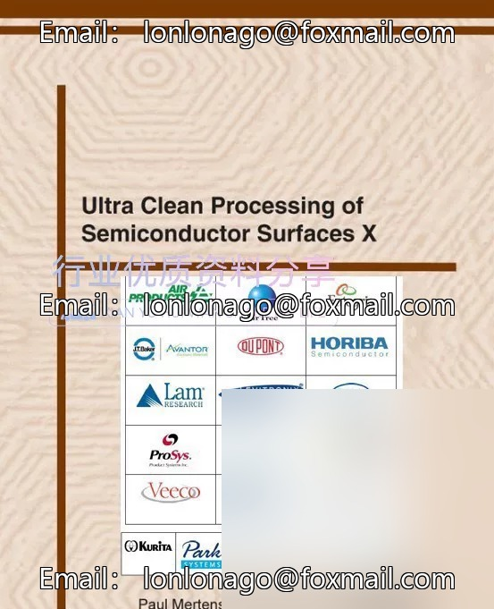
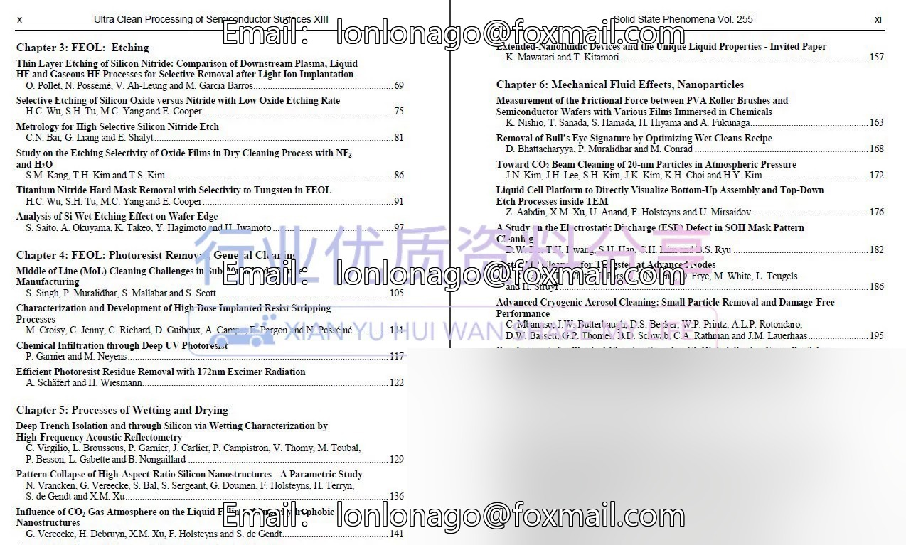
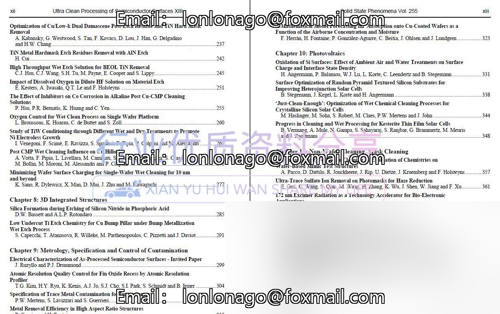
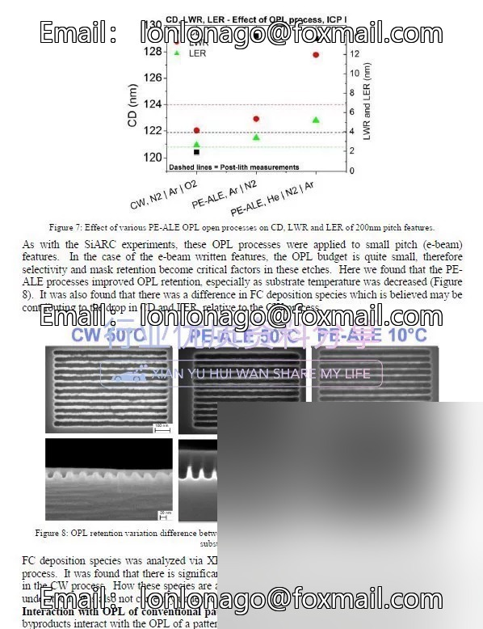
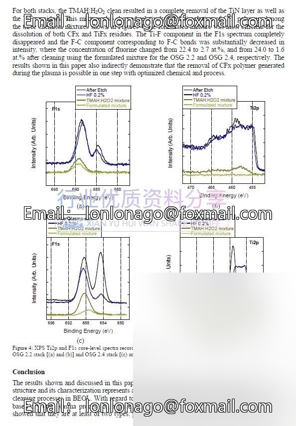
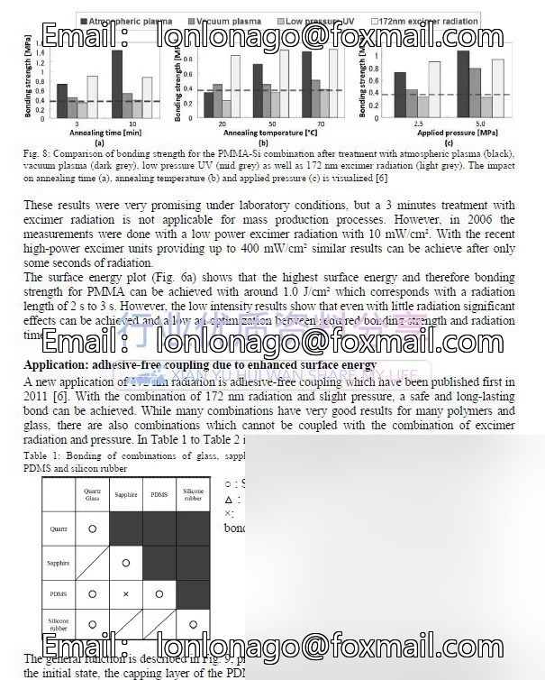

# #pdf[Super clean processing technology for semiconductor surfaces], the materials introduce including integrated circuits

## Body

#pdf[Super Clean Processing Technology for Semiconductor Surfaces], the material introduces relevant content including pollution control, cleaning, and surface treatment during fabrication processes of integrated circuits, such as lithography, etch, and CMP polishing, as well as applications in the photovoltaic field. This full English reference material has great value.

Take a photo and send the electronic original file directly! For the image with file parts, please confirm before placing an order! Since the electronic data is copyable, no return is allowed after purchase! Thank you for understanding!

The material covers ultra clean processing of semiconductor surfaces, including contamination control, cleaning and surface treatment in integrated circuit manufacturing; it also references industry-quality sources, vendors and research materials.

<!-- AI_ENRICHED -->

## Images

## Payment

Here is a pay link on Stripe ( https://buy.stripe.com/3cs8yP7sY87d0vu9AB ). Please contact me lonlonago@foxmail.com after funding $89, and I will send you a complete data files , thank you!

